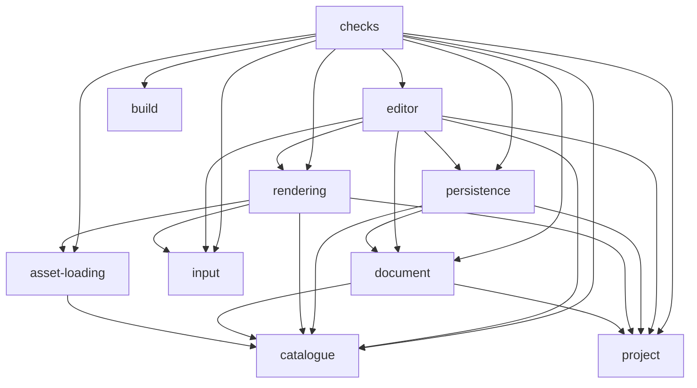

<!-- Generated by npm run graph:architecture; do not edit -->
# Implemented import graph

An arrow means imports, including type-only and dynamic imports. Checks are consumer
tests, including tests co-located with their implementation. Build is the existing
Vite/ESLint/Vitest configuration and architecture tooling.

Full file/line/import evidence and source hashes: [architecture-graph.json](architecture-graph.json).
