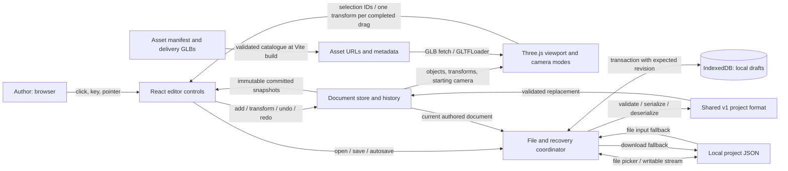

# Architecture v0.1

Spatial Experience Builder (SEB), developed by Meshworks for VThere.
Reviewed 26 September 2026 against `dev` at `fcf4cb4` and its current implementation.
This is the M1 architecture baseline; the second diagram labels later product work.

## Implemented editor and data flow

The authored document is authoritative. React and Three.js project it; neither is a
second saved project. The store owns immutable snapshots and reversible commands;
selection and camera navigation are session state. Pointer previews and rendering
stay outside React. A completed drag produces one transform command; cancellation
produces none. The current visitor camera is inside the editor application.

The v1 document contains stable project/scene/object IDs, one environment-backed
scene, ordered asset references, transforms and a starting camera. The initial grid
has no complete project until a room is chosen or a valid file is opened.
See [project types](../web/shared/project/project-types.ts) and the
[representative fixture](../web/shared/project/fixtures/m1-project.json).

## Hosting and planned product boundary

```mermaid
flowchart LR
  Repo[Private GitHub repository] -->|PR / push: locked build and checks| CI[GitHub Actions: Ubuntu]
  CI -->|tested Docker image and release descriptor| Registry[Private GHCR]
  Registry -->|manual Deploy: exact image digest| Host[Caddy: dev and production]
  Host -->|HTTPS with team access gate: app / GLBs| Editor[Current browser editor]
  Wiki[Separate Wiki.js handbook] -->|wiki branch: content backup| Repo
  subgraph Planned[Planned M2 / M3 product components]
    API[ASP.NET Core API and Identity]
    DB[(PostgreSQL: accounts, projects, publications)]
    Assets[Protected asset storage]
    Player[Shared player: preview and separate visitor]
    API -->|EF Core / Npgsql transactions| DB
    API -->|authorize asset bytes| Assets
    Player -->|HTTPS: published snapshot and assets| API
  end
  Editor -.->|M2: authenticated HTTPS draft saves| API
  Editor -.->|M2: isolated preview snapshot| Player
```

The current application has no API or application database. Wiki.js and its database
are documentation infrastructure, separate from SEB projects. M1 IndexedDB/JSON is
local recovery and interchange. M2 adds durable PostgreSQL projects/accounts; M3
publication uses persisted snapshots and server-enforced access. The separate visitor
build must exclude authoring code. See [deployment](deployment.md).

## Component responsibility map

These are the existing accountable M1 Story/Task assignees read from Jira on
26 September 2026, not new assignments or claims that their full tasks are done.
The owning issue retains the live responsibility when a name changes.

| Component / contract                                         | Existing owner                   | Jira work                                                    |
| ------------------------------------------------------------ | -------------------------------- | ------------------------------------------------------------ |
| Editor controls, selection integration and authoring flow    | Muhammad Nur Fadzly BIN ZULKIFLI | [SCRUM-16](https://meshworkss.atlassian.net/browse/SCRUM-16) |
| Three.js loading, camera navigation and synchronized picking | zifeng lim                       | [SCRUM-9](https://meshworkss.atlassian.net/browse/SCRUM-9)   |
| Custom manipulation and committed transforms                 | Ming Jie SHI                     | [SCRUM-14](https://meshworkss.atlassian.net/browse/SCRUM-14) |
| Reversible commands and history branching                    | dalton koh                       | [SCRUM-15](https://meshworkss.atlassian.net/browse/SCRUM-15) |
| Project schema, validation and reconstruction                | Foo Rui Qin                      | [SCRUM-5](https://meshworkss.atlassian.net/browse/SCRUM-5)   |
| IndexedDB recovery and JSON file operations                  | Foo Rui Qin                      | [SCRUM-31](https://meshworkss.atlassian.net/browse/SCRUM-31) |
| Asset manifest, delivery and GLB validation                  | dalton koh                       | [SCRUM-18](https://meshworkss.atlassian.net/browse/SCRUM-18) |
| CI, tested artifacts and deployment integration              | Muhammad Nur Fadzly BIN ZULKIFLI | [SCRUM-76](https://meshworkss.atlassian.net/browse/SCRUM-76) |

The future shared player, API/Identity and PostgreSQL/publication owners are still
unassigned in [SCRUM-64](https://meshworkss.atlassian.net/browse/SCRUM-64),
[SCRUM-66](https://meshworkss.atlassian.net/browse/SCRUM-66),
[SCRUM-68](https://meshworkss.atlassian.net/browse/SCRUM-68) and
[SCRUM-70](https://meshworkss.atlassian.net/browse/SCRUM-70). This baseline does not
assign them on the team's behalf.

## Edit, save and reload trace

1. Choose a room, then place a crate. `App.tsx` calls `createProject`/`addObject` in
   the document store; controls and viewport receive the same stable object ID.
2. Moving commits `setTransform`; Undo restores its previous transform. The store
   publishes a new snapshot for each committed operation.
3. The coordinator in `App.tsx` captures that snapshot and edit sequence.
   `local-drafts.ts` serializes validated JSON and checks the expected storage
   revision in an IndexedDB transaction. Only a committed transaction reports success.
4. Save/Save As uses `project-files.ts`. A file write compares the last known disk
   text before replacing it; closing the writable stream confirms completion.
   Browsers without file pickers use JSON upload/download instead.
5. Reload validates the browser record and project again before `loadProject`
   replaces the store. IDs, object order, transforms and starting camera survive;
   incompatible undo history is cleared. A remembered file needs an explicit Save
   to reconnect permission. An invalid file, failed write or conflict preserves work.

Run `npm run test:recovery` from `web/` against the development server for the
place–move–undo–save–reload check and failure cases. The
[setup guide](../README.md#development) provides commands and verification limits. Asset
rights remain pending in the manifest; the diagram does not imply content approval.
