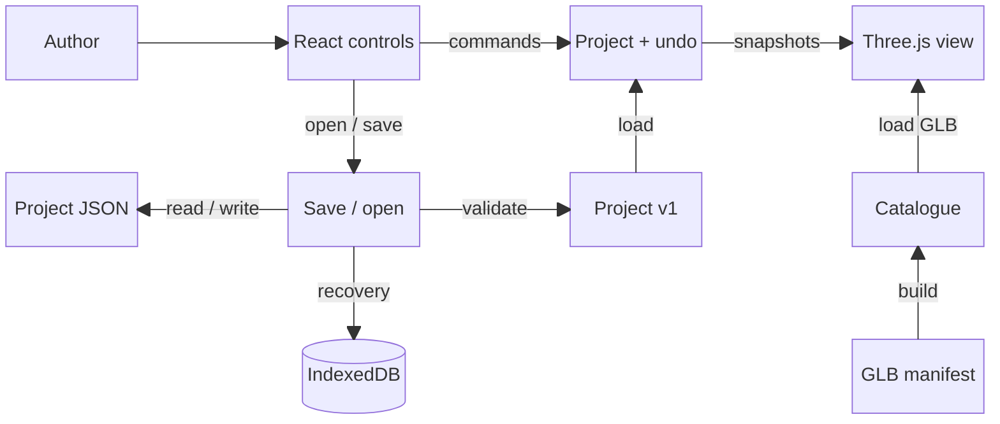
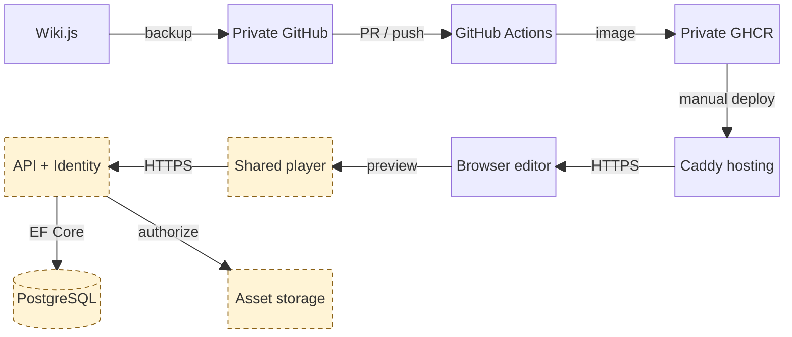

# Architecture v0.1

Spatial Experience Builder (SEB), developed by Meshworks for VThere.
Reviewed 26 September 2026 against `dev` at `fcf4cb4` and its current implementation.
This is the M1 architecture baseline; the second diagram labels later product work.
Recovery and viewport boundaries below were updated on 29 September against `ada62a1`
and the audit fixes on `fix/editor-audit`.

## Implemented editor and data flow

Read the top row left to right. Saving branches down from the controls; asset loading
runs up the right side. Controls also receive document snapshots and viewport
selection/drag results. Saving captures the current document; files and IndexedDB
support both reading and writing. These return paths are omitted from the drawing
to keep the main connections clear.

The authored document is authoritative. React and Three.js project it; neither is a
second saved project. The store owns immutable snapshots and reversible commands;
selection and camera navigation are session state. Pointer previews and rendering
stay outside React. A completed drag produces one transform command; cancellation
produces none. The current visitor camera is inside the editor application. Entering
visitor mode or a project-switching decision cancels pending transform previews;
visitor navigation cannot invoke authoring controls or file saving.

The v1 document contains stable project/scene/object IDs, one environment-backed
scene, ordered asset references, transforms and a starting camera. The initial grid
has no complete project until a room is chosen or a valid file is opened.
See [project types](../web/shared/project/project-types.ts) and the
[representative fixture](../web/shared/project/fixtures/m1-project.json).

## Hosting and planned product boundary

Read across the top row, down at GHCR, then right to left through the second row.
The API branches down to the two data stores. **Dashed amber boxes are planned M2/M3
components.** The editor will also save drafts directly to the API over authenticated
HTTPS; that direct connection is described here to avoid a line through the player.

CI uses Ubuntu and produces a tested Docker image plus its release descriptor.
Manual deployment selects the exact image digest for development or production.
Caddy serves the app and GLBs behind the team access gate. The planned API uses
ASP.NET Core/Identity and EF Core/Npgsql; the shared player serves both editor preview
and the separate visitor application.

The current application has no API or application database. Wiki.js and its database
are documentation infrastructure, separate from SEB projects. M1 IndexedDB/JSON is
local recovery and interchange. M2 adds durable PostgreSQL projects/accounts; M3
publication uses persisted snapshots and server-enforced access. The separate visitor
build must exclude authoring code. See [deployment](deployment.md).

## Interfaces and responsibility

| Component                          | Current boundary contract                                                                                                                                   |
| ---------------------------------- | ----------------------------------------------------------------------------------------------------------------------------------------------------------- |
| Editor controls                    | Read document/selection snapshots and invoke commands; do not maintain a second saved scene.                                                                |
| Document store and history         | `createProject`, `loadProject`, `addObject`, `setTransform`, Undo/Redo and commit subscriptions.                                                            |
| Three.js viewport and manipulation | Project document objects into meshes; report stable selection IDs and commit one transform after a completed drag.                                          |
| Project format                     | Validate raw JSON and asset kinds before reconstruction; serialize stable IDs, ordered objects, transforms and starting camera.                             |
| Recovery                           | `useProjectSession` coordinates manual file saves and quiet backups; `saveRecoverySession` / `loadRecoverySession` validate the active session and use expected storage revisions. Legacy drafts remain readable for migration. |
| Project files                      | `writeProjectFile` checks last-known disk text and commits on stream close; JSON upload/download is the fallback.                                           |
| Asset catalogue                    | `CatalogueAsset` supplies immutable ID, kind, URL, thumbnail and placement metadata from the validated manifest.                                            |
| Build and hosting                  | CI produces runnable web files and a commit identifier; branch builds also produce an immutable image and release descriptor consumed by manual deployment. |

Named owners and their existing owning Jira issues are maintained in the
[component responsibility map on SCRUM-113](https://meshworkss.atlassian.net/browse/SCRUM-113).
That planning record also identifies unassigned future components; assignments and
completion status remain outside this technical specification.

## Edit, save and reload trace

1. Choose a room, then place a crate. `App.tsx` calls `createProject`/`addObject` in
   the document store; controls and viewport receive the same stable object ID.
2. Moving commits `setTransform`; Undo restores its previous transform. The store
   publishes a new snapshot for each committed operation.
3. `use-project-session.ts` captures committed document and history snapshots after
   a two-second editing pause. `local-drafts.ts` writes them with the last manual-save
   baseline to one active IndexedDB record, checking the expected storage revision.
   Only a committed transaction reports success. Backup failures pause retries until Save.
4. Save/Save As uses `project-files.ts`. A file write compares the last known disk
   text before replacing it; closing the writable stream confirms completion.
   Browsers without file pickers use JSON upload/download instead. Downloads do not
   confirm disk completion or clear the dirty state, but Save still retries recovery.
5. Reload validates the browser record and project again before `loadProject`
   replaces the store. IDs, object order, transforms and starting camera survive;
   valid undo history and the file's dirty state are restored. Invalid history is
   discarded with a warning while keeping the scene. A remembered file needs an
   explicit Save to reconnect permission. Legacy migration offers the newest readable
   backup when another is damaged, retaining rejected records. New/Open asks about
   unsaved changes and commits the replacement backup before changing the visible
   project. An invalid file, failed write or conflict preserves work.

Run `npm run test:recovery`, `npm run test:history` and `npm run test:integration`
from `web/` against the development server for persistence and viewport integration
checks. CI runs these alongside the editor shell suite. The
[setup guide](../README.md#development) provides commands and verification limits. Asset
rights remain pending in the manifest; the diagram does not imply content approval.
